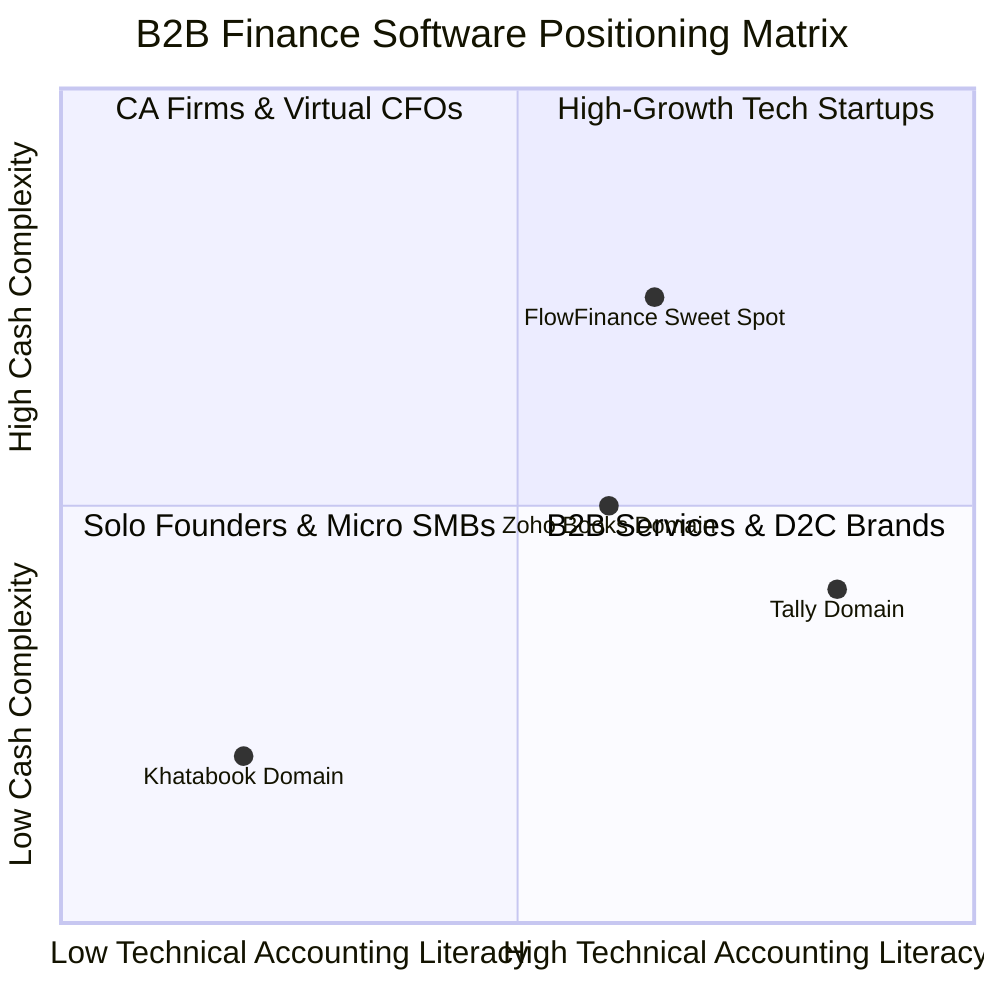

# FlowFinance Go-To-Market (GTM) Strategy & Market Entry Plan

**Document:** 01_GTM_Plan.md  
**Track:** Consulting & Business Development Track  
**Platform Focus:** FlowFinance ([flowfinancebusiness.com](https://www.flowfinancebusiness.com/))  
**Target Market:** Indian Startups, B2B SMBs, and Chartered Accountant (CA) Advisory Firms  

---

## 1. Executive Summary & Strategic Context

FlowFinance is an AI-powered financial intelligence and cash management platform built specifically for Indian startups, high-growth SMBs, and Chartered Accountant (CA) firms ([flowfinancebusiness.com](https://www.flowfinancebusiness.com/)). 

### The Market Dilemma
The Indian MSME and startup ecosystem faces a severe financial visibility paradox:
1. **Bookkeeping is solved for compliance, but broken for decision-making:** Tools like TallyPrime dominate accounting compliance (>70% desktop market share among CAs), but provide static, backward-looking ledgers rather than forward-looking cash intelligence.
2. **The Delayed Payment Crisis:** Indian MSMEs face an estimated **₹7.34 lakh crore to ₹8.1 lakh crore** locked up in delayed trade receivables ([GAME / FISME / C2FO Delayed Payments Report via Economic Times](https://economictimes.indiatimes.com/small-biz/sme-sector/delayed-payments-crisis-msmes-blocked-funds-working-capital/articleshow/96328994.cms)). Over 10.11 crore enterprises are registered across the Udyam portal and Udyam Assist Platform ([Ministry of MSME](https://msme.gov.in/)), yet over 80% lack real-time visibility into their forward 90-day cash runway.
3. **Statutory Pressure via Section 43B(h):** The introduction of Section 43B(h) of the Income Tax Act strictly disallows corporate tax deductions for purchases from registered micro and small enterprises unless paid within 45 days ([PIB / Ministry of Finance](https://pib.gov.in/)). This makes real-time invoice aging and cash forecasting a mandatory operational necessity rather than a luxury.

### FlowFinance's Strategic Opportunity
FlowFinance does not seek to displace core compliance ledgers. Instead, it positions itself as an **intelligent operational and forecasting layer** connecting to bank accounts via the Reserve Bank of India (RBI)-regulated Account Aggregator (AA) framework ([flowfinancebusiness.com](https://www.flowfinancebusiness.com/)). By combining cash position tracking, runway modeling, scenario planning, and the natural-language **Flowy AI Copilot**, FlowFinance bridges the gap between raw transactions and strategic executive action.

---

## 2. Industry Landscape & Competitor Benchmarking

FlowFinance operates at the convergence of three software categories: Traditional Desktop Accounting, Cloud ERP/Accounting Suites, and Micro-Merchant Mobile Ledgers.

| Competitor | Core Positioning | Target Customer | Pricing Structure | Key Strengths | Critical Gaps vs. FlowFinance |
| :--- | :--- | :--- | :--- | :--- | :--- |
| **FlowFinance** | AI-native financial intelligence & runway copilot | Startups (Pre-Seed to Series A), B2B Agencies, CA Firms | • Essential: ₹1,999/mo<br>• Growth: ₹3,999/mo<br>• Professional: ₹7,999/mo<br>*(7-day free trial)* | • Live Account Aggregator bank sync<br>• Natural language Flowy Copilot<br>• 90-day runway scenario modeling<br>• Automated investor & MIS decks | Early-stage brand awareness; requires bi-directional sync with desktop accounting systems. |
| **Tally (TallyPrime)** | Dominant desktop ERP & statutory compliance engine | Traditional Indian MSMEs, Accountants, CAs | • Silver (Single): ₹22,500 + GST perpetual<br>• Gold (Multi): ₹67,500 + GST perpetual<br>*(TSS renewal: ~₹4,500/yr)* | • Unrivaled CA trust and market penetration<br>• Flawless GST, e-Way, and TDS filings<br>• Complete offline capability | Offline-first desktop architecture; lack of native cloud-first bank syncing; no forward-looking cash forecasting. |
| **Zoho Books** | Comprehensive cloud accounting & business suite | Digitized SMBs, Mid-market enterprises | • Standard: ₹749/mo<br>• Professional: ₹1,499/mo<br>• Premium: ₹2,999/mo<br>• Enterprise: ₹7,999/mo | • Deep integration with Zoho suite (CRM, Payroll, Inventory)<br>• Strong cloud collaboration and audit trails | High configuration complexity; lacks natural language AI copilot; does not specialize in startup runway planning. |
| **Khatabook** | Mobile-first digital ledger & receivables tracker | Micro-merchants, retail shop owners, kiranas | • Freemium core<br>• Premium add-ons: ~₹3,000–₹5,000/yr (Biz Analyst / Desktop) | • Extreme mobile simplicity<br>• Vernacular language support<br>• High viral distribution in Tier 2/3 cities | Tailored for informal *udhar bahi*; lacks runway forecasting, multi-scenario modeling, and corporate MIS reporting. |
| **Vyapar** | Billing, inventory, and invoicing software | Small retail traders, distributors, wholesalers | • Mobile: ~₹699–₹999/yr<br>• Desktop: ~₹2,399–₹3,399/yr | • Barcode scanning & point-of-sale billing<br>• Offline desktop functionality<br>• Affordable pricing for small shops | Narrow billing focus; lacks banking integration, venture reporting, and corporate cash flow intelligence. |
| **Refrens** | Invoicing, proposal, and lightweight client management | Freelancers, creative agencies, boutique consultancies | • Free core<br>• Premium: ~₹3,000–₹10,000/yr | • Elegant client proposals and quotation workflows<br>• Quick invoice generation | Limited financial intelligence; no Account Aggregator bank feeds; no scenario planning or burn analytics. |
| **Razorpay (RazorpayX / Capital)** | Neo-banking, automated payouts, and working capital | Tech startups, digitally mature SMBs | • Transaction-based fees<br>• Credit underwriting interest spreads | • Deep payment gateway integration<br>• Instant collateral-free working capital lines<br>• Payroll automation | Tied to specific banking partners (current accounts); focuses on transaction processing rather than financial modeling and multi-bank analytics. |
| **Clear (formerly ClearTax)** | Tax compliance, enterprise e-invoicing & vendor portal | Mid-to-large corporates, high-billing MSMEs | • Module-based SaaS: ₹10,000–₹1,00,000+/yr | • Direct GSTN integration<br>• Enterprise vendor portal and ITC reconciliation | Heavy enterprise tax compliance tool; does not provide day-to-day cash forecasting or founder runway modeling. |

*Sources:* [FlowFinance Comparison Hub](https://www.flowfinancebusiness.com/compare), [Zoho Books Pricing](https://www.zoho.com/in/books/pricing/), [Tally Solutions](https://tallysolutions.com/), [Refrens](https://www.refrens.com/).

---

## 3. Total Addressable Market (TAM), SAM, and SOM Analysis

To size the market opportunity rigorously, we utilize official Government of India enterprise registration records and apply transparent, labeled conversion assumptions.

### Market Sizing Definitions & Sources
* **Total Registered Enterprises:** Cumulative registrations across the Udyam Registration Portal (URP) and Udyam Assist Platform (UAP) crossed **10.11 crore** in late 2026, with over **5.58 crore** formal registrations on the core Udyam portal ([Ministry of MSME Official Dashboard](https://msme.gov.in/) & [PIB](https://pib.gov.in/)).
* **Formal GST-Registered MSME Base:** Of the formal Udyam-registered enterprises, an estimated **1.40 crore to 1.50 crore** file regular GST returns ([GST Council / Press Information Bureau](https://pib.gov.in/)).
* **Average Revenue Per User (ARPU):**
  * FlowFinance’s core plans are ₹1,999/mo (Essential), ₹3,999/mo (Growth), and ₹7,999/mo (Professional) ([flowfinancebusiness.com/pricing](https://www.flowfinancebusiness.com/pricing)).
  * *Assumption 1:* We assume a weighted-average blended ARPU of **₹3,200 / month (₹38,400 / year)**, reflecting a mix of 55% Essential, 35% Growth, and 10% Professional subscribers.

### Sizing Derivation Table

| Level | Definition & Criteria | Target Units | Derivation & Assumptions | Annual Market Value (INR) |
| :--- | :--- | :--- | :--- | :--- |
| **TAM** (Total Addressable Market) | All formal, digitized MSMEs and registered startups in India requiring financial management software. | **1.45 Crore** enterprises | Official count of GST-registered enterprises with active digital banking and compliance filings ([PIB](https://pib.gov.in/)).<br>*Assumption:* 100% addressable by financial software. | **₹55,680 Crore** (~$6.7B USD)<br>*(1.45 Cr × ₹38,400/yr)* |
| **SAM** (Serviceable Addressable Market) | Digitally progressive B2B SMBs, venture-funded/bootstrapped tech startups, and CA advisory clients with multi-bank operations and >₹50L annual turnover. | **12.5 Lakh** enterprises | *Assumption 2:* ~8.6% of GST-registered businesses operate in modern services, D2C, technology, or engage formal CA advisory services needing live cash intelligence rather than simple desktop billing. | **₹4,800 Crore** (~$578M USD)<br>*(12.5 Lakh × ₹38,400/yr)* |
| **SOM** (Serviceable Obtainable Market - 3 Year Target) | Realistic market share captured via direct acquisition, CA distribution networks, and startup ecosystem partnerships. | **25,000** paying subscribers | *Assumption 3:* Capturing a 2.0% market share of SAM over a 36-month execution horizon across top 8 Indian metropolitan clusters (Tier 1/2 hubs). | **₹96 Crore** (~$11.5M ARR)<br>*(25,000 × ₹38,400/yr)* |

---

## 4. Target Customer Segmentation Matrix

FlowFinance serves four distinct customer segments with varying operational complexities, financial literacy, and buying dynamics:



### Segment Characteristics

1. **Pre-Seed & Seed Funded Tech Startups:**
   * *Profile:* 5–25 team members, ₹1 Cr–₹10 Cr capital raised, institutional investors or angel syndicates.
   * *Core Problem:* Burn rate uncertainty, ad-hoc hiring impact, board MIS preparation taking 2–3 days per month.
   * *Decision Maker:* Founder / CEO / Co-founder.
2. **B2B Services & Digital Agencies:**
   * *Profile:* 10–50 team members, IT services, creative agencies, logistics, consulting.
   * *Core Problem:* Severe cash delays (60–90 day payment cycles), lumpy project billings, tracking client-level profitability.
   * *Decision Maker:* Managing Director / Agency Founder.
3. **Scaling D2C & Omnichannel Brands:**
   * *Profile:* ₹1 Cr–₹20 Cr GMV, inventory-heavy, multichannel sales (Shopify, Amazon, Quick Commerce, offline retail).
   * *Core Problem:* Working capital locked in inventory, high ad spend burn (Meta/Google), payment gateway settlement reconciliation delays.
   * *Decision Maker:* Founder / Growth Lead / Finance Manager.
4. **Chartered Accountant (CA) Firms & Virtual CFOs:**
   * *Profile:* 3–15 member accounting firms managing 30–100 SMB corporate clients.
   * *Core Problem:* Clients dumping shoe-boxes of bank statements and invoices at month-end; time-consuming manual categorization; low-margin compliance work.
   * *Decision Maker:* Senior Partner / Principal CA.

---

## 5. Beachhead Segment Analysis & Strategic Options

A successful GTM strategy requires selecting an initial wedge market that exhibits high urgency, high willingness to pay, and rapid time-to-value. Below are the three viable beachhead options evaluated objectively:

### Option A: B2B Services Agencies (Design, IT, Performance Marketing)
* **Evidence of Need:** Average Days Sales Outstanding (DSO) ranges from 60 to 90 days. Most agencies operate on lean margins with high payroll overhead on the 1st of every month. A 15-day delay in client payment threatens payroll solvency.
* **Advantages:** High digital literacy; active on web/cloud tools (Slack, Notion, Google Workspace); self-serve onboarding.
* **Trade-offs:** Moderate annual churn if agency businesses downsize; price-sensitive during economic contractions.

### Option B: Chartered Accountant (CA) Channel Partners
* **Evidence of Need:** Over 3.5 lakh active Chartered Accountants in India manage millions of MSME balance sheets. CAs spend up to 40% of their billable hours manually cleaning bank statements and chasing clients for invoice details.
* **Advantages:** 1-to-many distribution leverage. Onboarding one CA practice can bring 15–30 client workspaces onto FlowFinance. CAs act as trusted advisors; clients rarely churn if their CA manages the tool.
* **Trade-offs:** High initial inertia; traditional CAs are deeply entrenched in Tally desktop shortcuts; requires an easy export path into Tally.

### Option C: Early-Stage Venture-Backed Tech Startups (Pre-Seed to Series A)
* **Evidence of Need:** Founders lack financial backgrounds and cannot afford a full-time CFO (₹25L–₹50L/year salary). Investors demand monthly MIS decks and burn updates.
* **Advantages:** Instant product-market fit for Flowy AI Copilot and Planning Studio; high willingness to pay (₹3,999/mo is trivial against venture funding); strong ecosystem concentration (incubators, accelerators).
* **Trade-offs:** Smaller total pool of venture-funded startups compared to general SMBs; market vulnerability during funding slowdowns.

*Recommendation for Strategy Formulation:* In the accompanying operational plans, we recommend that the user evaluate a **Dual Beachhead Strategy**: using **B2B Services Agencies** as the primary direct self-serve acquisition wedge, while simultaneously activating **CA Firms** as the compounding distribution flywheel.

---

## 6. Value Proposition & Messaging Architecture

FlowFinance’s messaging must directly counter the friction points of existing tools:

```
[Target Audience: Founder / Non-Finance Operator]
Pain Point: "I have money in the bank, but I don't know if I can afford 2 new hires next month."
FlowFinance Positioning: "Real-time cash forecasting and runway planning without complex Excel models."
Headline Message: "Know your runway. Eliminate cash surprises. Make confident decisions."

[Target Audience: B2B Agency Owner]
Pain Point: "Clients take 60 days to pay, and my salary bill is due on the 1st."
FlowFinance Positioning: "Live receivables aging tracking and automated cash-flow alerts powered by bank data."
Headline Message: "Stop chasing spreadsheets. Protect your payroll with automated cash intelligence."

[Target Audience: Chartered Accountant Channel Partner]
Pain Point: "Clients send messy bank PDFs at the last minute; my team wastes hours on manual data entry."
FlowFinance Positioning: "Instant Account Aggregator bank reconciliation and automated client MIS reporting."
Headline Message: "Supercharge your advisory practice. Deliver automated CFO-grade reports to every client."
```

---

## 7. Phased Go-To-Market Execution Roadmap

```mermaid
flowchart TD
    subgraph Phase 1: Foundation & Wedge (Weeks 1–4)
        A1["Validate Direct Self-Serve Funnel with B2B Agencies"] --> A2["Launch Pre-Built Ingestion Fallbacks (PDF Parser)"]
        A2 --> A3["Seed Initial 25 Startup Pilot Workspaces"]
    end
    subgraph Phase 2: Distribution Engine (Weeks 5–8)
        B1["Roll out CA Partner Alliance (10% Tier 1 Commission)"] --> B2["Activate Founder Communities (TiE, Headstart, YC Alumni)"]
        B2 --> B3["Deploy Campus / Student Ambassador Network"]
    end
    subgraph Phase 3: Scale & Institutional Partnerships (Weeks 9–12)
        C1["Institutional Tie-ups (Incubators, Co-Working Hubs)"] --> C2["Tally Bridge Export Utility Launch"]
        C2 --> C3["Achieve 500+ Verified Paid Workspaces"]
    end
    Phase 1 --> Phase 2 --> Phase 3
```

1. **Phase 1: Foundation & Direct Beachhead (Weeks 1–4):**
   * Target tech-forward B2B agencies and seed-funded startups via targeted LinkedIn thought leadership and community outreach.
   * Polish the 7-day free trial onboarding to achieve <5 minute time-to-value.
2. **Phase 2: Distribution Engine & Channel Activation (Weeks 5–8):**
   * Launch the formal CA Referral & Virtual CFO Partner program.
   * Deploy campus ambassadors in premier B-schools and entrepreneurship cells (E-Cells) to drive grassroots startup registrations.
3. **Phase 3: Scale & Ecosystem Integrations (Weeks 9–12):**
   * Integrate structured partnerships with startup incubators (T-Hub, NSRCEL, IIT E-Cells) and co-working spaces (WeWork, Awfis).
   * Launch the desktop Tally XML/TDL bridge to eliminate CA workflow friction.

---

*Sources Cited in this Document:*
1. [FlowFinance Official Website](https://www.flowfinancebusiness.com/)
2. [FlowFinance Pricing](https://www.flowfinancebusiness.com/pricing)
3. [FlowFinance Competitor Comparisons](https://www.flowfinancebusiness.com/compare)
4. [Ministry of MSME Dashboard](https://msme.gov.in/)
5. [Press Information Bureau - Udyam Registration Milestones](https://pib.gov.in/)
6. [Economic Times - MSME Delayed Payments Report](https://economictimes.indiatimes.com/small-biz/sme-sector/delayed-payments-crisis-msmes-blocked-funds-working-capital/articleshow/96328994.cms)
7. [Zoho Books Pricing](https://www.zoho.com/in/books/pricing/)
