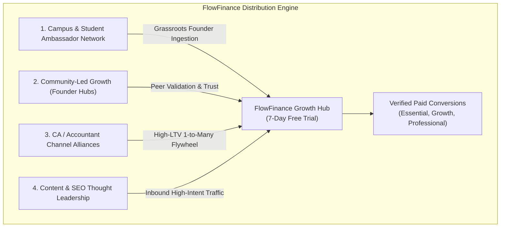

# FlowFinance Multi-Channel Distribution Strategy

**Document:** 03_Distribution_Strategy.md  
**Track:** Consulting & Business Development Track  
**Platform Focus:** FlowFinance ([flowfinancebusiness.com](https://www.flowfinancebusiness.com/))  
**Target Market:** Indian Founders, SMB Operators, and CA Practices  

---

## 1. Executive Summary & Distribution Architecture

Distribution in early-stage B2B fintech cannot rely exclusively on expensive digital ad channels where customer acquisition costs (CAC) often exceed lifetime value (LTV). FlowFinance requires a **compounding, multi-tiered distribution engine** that leverages trust-based channels, grassroots student ambassadors, professional accounting networks, and organic high-authority content.

---

## 2. Pillar 1: Campus Ambassador & E-Cell Network

Student entrepreneurs, campus incubators, and university-based startups represent an underserved, high-velocity segment of early-stage business creation in India.

### Target Institutions & Alliances
* **Premier Engineering E-Cells:** IIT Bombay (E-Cell), IIT Delhi, BITS Pilani (CEL), IIT Madras.
* **Top B-Schools & Incubation Centers:** IIM Ahmedabad (CIIE), IIM Bangalore (NSRCEL), ISB D-Labs, SPJIMR.
* **Undergraduate Business Colleges:** SRCC, St. Xavier's Mumbai, Christ University Bangalore, NMIMS.

### Ambassador Persona & Selection
* **Profile:** Second or final-year undergraduate or MBA students serving on E-Cell executive committees, finance clubs, or running early student ventures.
* **Role Title:** *FlowFinance Campus Venture Fellow*.

### Operational Playbook & Responsibilities
1. **Host Campus Startup Masterclasses:** Conduct 45-minute interactive workshops: *"Startup Financial Modeling & Runway Management: How to Survive Year 1."* Use FlowFinance’s demo workspace to illustrate scenario modeling.
2. **Onboard Campus Incubation Cohorts:** Provide university-incubated student startups with dedicated 30-day extended onboarding support.
3. **Distribution Incentive Structure (Strictly Compliance-Bound):**
   * Student ambassadors receive structured milestone recognition: certificates of excellence, LinkedIn recommendations, virtual CFO mentorship sessions, and fixed performance stipends linked to verified startup activations.
   * *Anti-Abuse Rule:* Conversions are only valid if associated with an active registered entity or university-recognized startup project with verified bank statement uploads. Self-referrals and ghost accounts are strictly disallowed.

---

## 3. Pillar 2: Community-Led Growth (CLG) & Ecosystem Hubs

Indian startup founders rely heavily on tight-knit founder communities for tool recommendations, peer validation, and vendor vetting.

### Key Ecosystem Touchpoints
* **Curated Founder Communities:** TiE (The Indus Entrepreneurs) Chapters (Mumbai, Bengaluru, Delhi-NCR), Headstart Network, SaaSBoomi, eChai Ventures.
* **Incubation & Accelerator Networks:** T-Hub (Hyderabad), NSRCEL, Kerala Startup Mission (KSUM), Wadhwani Foundation.
* **Co-Working Communities:** WeWork Labs, Awfis, 91springboard, Innov8.

### Tactical Execution Framework
1. **The "Financial Health Audit" Clinic:**
   * Partner with community chapter leads to host bi-weekly virtual clinics.
   * Offer 5 free, anonymized financial teardowns per session, demonstrating how Flowy AI Copilot identifies cash leaks and payment collection bottlenecks.
2. **Co-Branded Resource Toolkits:**
   * Develop the *"Early-Stage Founder Finance Stack"* toolkit in partnership with community managers.
   * Include actionable spreadsheets, Section 43B(h) checklists, and direct access to FlowFinance’s 7-day free trial.
3. **Founder-to-Founder Referral Loop:**
   * In-app referral program: Existing paid users who refer a peer founder receive 1 month of free platform credits or advanced scenario modeling features upon verified paid conversion.

---

## 4. Pillar 3: Chartered Accountant (CA) & Virtual CFO Channel

The CA ecosystem is FlowFinance’s **most scalable 1-to-many distribution channel**. A single practicing CA manages financial compliance and advisory for 20 to 100+ SMB clients.

### The Value Exchange for CAs
* **The CA’s Pain:** Chasing clients for bank statements, manual data entry, low-margin compliance work, and spending 3–4 days every month preparing basic MIS reports.
* **FlowFinance’s Solution:** Automated Account Aggregator bank reconciliation, standardized MIS generation, and AI-categorized ledgers that cut monthly review time by over 60%.
* **Commercial Incentive Alignment:**
  * **Level 2 Commission Structure:** CAs earn a **10% recurring commission on the first-month subscription** for every verified client workspace activated, alongside milestone rewards at 5, 7, and 10 verified conversions ([flowfinancebusiness.com/pricing](https://www.flowfinancebusiness.com/pricing)).
  * **Partner Practice Dashboard:** Free administrative console for CA firms managing 5+ active client accounts.

### CA Outreach Protocol
* Focus on young, tech-forward CA practitioners (aged 28–42) operating independent boutique advisory firms.
* Deliver tailored demonstrations emphasizing Tally compatibility and automated MIS deck generation.

---

## 5. Pillar 4: High-Authority Content & Inbound Thought Leadership

Financial software buyers perform significant research before committing to a tool. Content must address real operational, legal, and cash-flow challenges facing Indian businesses.

### Core Content Pillars

#### Pillar A: Statutory & Tax Compliance Breakdown
* *Topic 1:* **"Demystifying Section 43B(h): How MSMEs Can Use the 45-Day Payment Rule to Accelerate Collections."**
* *Topic 2:* **"Input Tax Credit (ITC) Traps: How to Reconcile GSTR-2B with Purchase Ledgers."**
* *Impact:* High search intent from business owners worried about tax penalties and working capital blocks.

#### Pillar B: Tactical Cash Flow & Runway Playbooks
* *Topic 1:* **"The Anatomy of Indian Agency Cash Flow: Why 60-Day Payment Terms Kill Profitable Agencies."**
* *Topic 2:* **"How to Build a Dynamic 3-Scenario Runway Model for Seed-Stage Startups."**
* *Impact:* Positions FlowFinance as the thought leader in startup runway and cash intelligence.

#### Pillar C: Interactive Financial Calculators
* Deploy free, ungated web calculators on `flowfinancebusiness.com/tools`:
  1. *Startup Burn & Runway Calculator*
  2. *Section 43B(h) Interest Penalty Calculator (Compound interest at 3x RBI bank rate)*
  3. *Days Sales Outstanding (DSO) Diagnostic Tool*
* Each calculator prompts the user to import their bank data or test the interactive demo workspace to automate the result.

---

## 6. Distribution Risk Mitigation & Ethical Boundaries

| Channel | Key Distribution Risk | Mitigation & Governance Protocol |
| :--- | :--- | :--- |
| **Campus Ambassadors** | Low-quality or non-business trial registrations. | Mandatory qualification: conversions must have an active GSTIN or business bank statement. |
| **CA Network** | Hesitation to adopt due to Tally loyalty. | Provide seamless CSV/Excel export bridges matching Tally ledger formats; position FlowFinance as an advisory layer, not a Tally replacement. |
| **Founder Communities** | Community backlash against overt self-promotion. | Zero unsolicited pitching. All community presence must be educational, masterclass-led, and approved by community admins. |
| **Content Marketing** | Low conversion from informational traffic. | Contextual in-content CTAs linking directly to interactive demo workspaces with zero signup friction. |

---

*Sources Cited in this Document:*
1. [FlowFinance Official Website & Features](https://www.flowfinancebusiness.com/)
2. [FlowFinance Pricing Plans](https://www.flowfinancebusiness.com/pricing)
3. [Ministry of MSME - Delayed Payments Regulations](https://msme.gov.in/)
4. [The Institute of Chartered Accountants of India (ICAI)](https://www.icai.org/)
