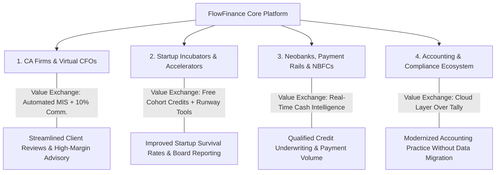
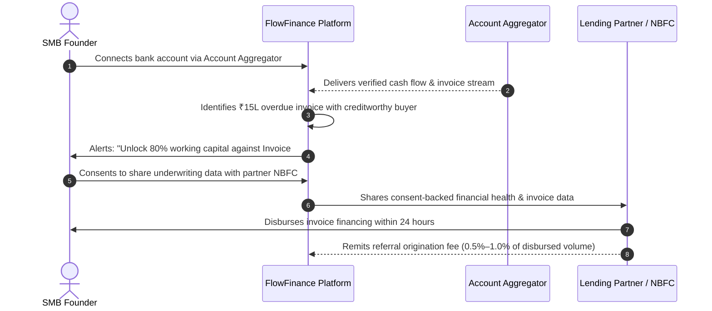

# FlowFinance Strategic Partnerships & Ecosystem Alliances Framework

**Document:** 04_Partnerships.md  
**Track:** Consulting & Business Development Track  
**Platform Focus:** FlowFinance ([flowfinancebusiness.com](https://www.flowfinancebusiness.com/))  
**Target Market:** Indian Founders, SMB Operators, and CA Practices  

---

## 1. Executive Summary: The Partnership Imperative

In B2B fintech, partnerships serve as **trust bridges** and **distribution accelerators**. For an emerging platform like FlowFinance ([flowfinancebusiness.com](https://www.flowfinancebusiness.com/)), establishing formal alliances with institutional entities, accounting practitioners, and financial infrastructure providers bypasses cold customer acquisition and anchors the platform within existing operational workflows.

This document details four high-impact partnership categories, outlining the **strategic rationale, value exchange, operational engagement model, and commercial terms** for each.

---

## 2. Partnership Matrix & Value Exchange



### Detailed Partner Category Breakdown

| Partner Category | Target Organizations | Value Delivered by FlowFinance | Value Received by Partner | Operational Integration Hook |
| :--- | :--- | :--- | :--- | :--- |
| **1. CA Firms & Virtual CFOs** | • Boutique CA firms (3–15 partners)<br>• Virtual CFO advisory agencies (e.g., CFO Bridge, FinOps consultancies) | • Automated Account Aggregator bank reconciliation.<br>• Instant client MIS decks and custom P&L reports.<br>• Anomaly detection for client audit reviews. | • Cuts manual bookkeeping hours by >60%.<br>• Enables transition from low-margin tax compliance to high-margin advisory.<br>• 10% first-month commission per verified paid client. | Partner Practice Portal with multi-tenant client workspace switching. |
| **2. Incubators & Accelerators** | • T-Hub (Hyderabad)<br>• NSRCEL (IIM Bangalore)<br>• SINE (IIT Bombay)<br>• Villgro, Wadhwani Foundation | • Free 3-month Growth Plan access for active cohort startups.<br>• Dedicated masterclasses on runway management and burn control.<br>• Automated investor update generation. | • Real-time cohort health tracking and runway visibility.<br>• Reduced failure rate due to unexpected cash exhaustion.<br>• Standardized reporting for institutional funding bodies. | Dedicated co-branded landing page (`flowfinancebusiness.com/partners/thub`) and cohort onboarding webinars. |
| **3. Neobanks, Payment Rails & NBFCs** | • Razorpay / RazorpayX<br>• Cashfree Payments<br>• Neo-banking partners (ICICI Bank, RBL)<br>• Working capital NBFCs | • High-intent MSME transaction visibility.<br>• Contextual payment link integration inside FlowFinance invoices.<br>• Direct Account Aggregator consent flows. | • Increased payment processing volume and higher current account stickiness.<br>• Data-backed credit underwriting leads for working capital lines. | API integration for payment link generation and embedded working capital pre-approval banners. |
| **4. Accounting & Compliance Resellers** | • Tally Certified Partners & System Integrators<br>• Regional accounting software vendors<br>• MSME business service consultants | • Value-added cloud analytics layer to sell on top of traditional Tally software.<br>• Additional high-margin recurring SaaS revenue stream. | • Differentiates traditional IT vendors from commodity box-pushers.<br>• Generates recurring software commissions alongside one-time ERP sales. | One-click Tally XML/TDL data export utility for seamless ledger sync. |

---

## 3. Tiered CA & Channel Partner Program Architecture

To scale distribution through Chartered Accountants systematically, FlowFinance implements a transparent three-tiered partner model:

### Partner Tier Breakdown

```
[Tier 1: FlowFinance Certified Associate]
• Threshold: 1–4 active client workspaces.
• Commercial Incentive: 10% commission on the first-month subscription for every verified paid client.
• Platform Benefits: Standard multi-client access, self-serve partner resource portal.

[Tier 2: FlowFinance Preferred Advisory Partner]
• Threshold: 5–14 active client workspaces.
• Commercial Incentive: 10% recurring first-month commission + milestone bonus (₹4,000 at 5 clients, ₹7,000 at 7 clients).
• Platform Benefits: Free internal workspace for the CA firm, dedicated account manager, co-branded MIS reporting.

[Tier 3: FlowFinance Elite Virtual CFO Partner]
• Threshold: 15+ active client workspaces.
• Commercial Incentive: 10% commission + maximum milestone bonus (₹11,000 at 10 clients) + customized rev-share for enterprise tiers.
• Platform Benefits: Early access to beta features, featured listing in FlowFinance's Verified Advisor Directory, joint PR and webinar co-hosting.
```

---

## 4. Institutional Incubator & Accelerator Playbook

### Program Name: *FlowFinance Runway Alliance*

#### 1. Partnership Value Proposition to Accelerators
Early-stage venture incubators face a constant risk: promising portfolio startups running out of money prematurely due to poor cash visibility. FlowFinance provides portfolio managers with an aggregated, privacy-compliant view of cohort runway health.

#### 2. The Offer Package
* **Cohort Perk:** 90 days of complimentary access to the **Growth Plan (valued at ₹11,997)** for all enrolled incubatees ([flowfinancebusiness.com/pricing](https://www.flowfinancebusiness.com/pricing)).
* **Educational Support:** Monthly workshop led by finance experts: *"Unit Economics & 90-Day Cash Flow Forecasting for Venture-Backed Founders."*
* **Investor Reporting Template:** Built-in standardized investor dashboard enabling startups to share one-click monthly updates with incubator directors.

#### 3. Execution Roadmap
* **Week 1–2:** Outreach to portfolio directors and incubator heads (T-Hub, NSRCEL, IIT E-Cells).
* **Week 3:** Finalize partnership MoU and launch co-branded landing page.
* **Week 4:** Conduct inaugural cohort masterclass and onboard initial batch of 15–20 startup workspaces.

---

## 5. Working Capital & Lending Integration Roadmap (Fintech Layer)

Delayed receivables of **₹7.34L Cr to ₹8.1L Cr** across Indian MSMEs ([GAME Delayed Payments Report](https://economictimes.indiatimes.com/small-biz/sme-sector/delayed-payments-crisis-msmes-blocked-funds-working-capital/articleshow/96328994.cms)) create a massive opportunity for embedded working capital financing.



* *Strategic Value:* Transforms FlowFinance from a pure SaaS expense into a value-generating liquidity engine for SMBs, opening a substantial secondary monetization channel via lending referral fees without balance sheet risk.

---

*Sources Cited in this Document:*
1. [FlowFinance Official Website & Pricing](https://www.flowfinancebusiness.com/pricing)
2. [FlowFinance Platform Capabilities](https://www.flowfinancebusiness.com/features)
3. [Economic Times / GAME - Delayed Payments in MSME Sector](https://economictimes.indiatimes.com/small-biz/sme-sector/delayed-payments-crisis-msmes-blocked-funds-working-capital/articleshow/96328994.cms)
4. [Reserve Bank of India Account Aggregator Guidelines](https://www.rbi.org.in/)
