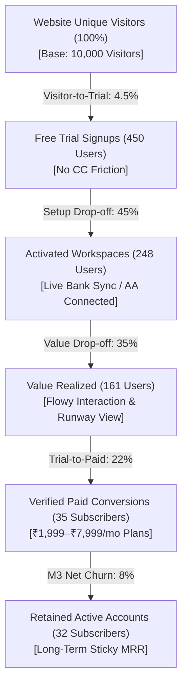

# FlowFinance Conversion, Activation & Retention Framework

**Document:** 05_Conversion_Framework.md  
**Track:** Consulting & Business Development Track  
**Platform Focus:** FlowFinance ([flowfinancebusiness.com](https://www.flowfinancebusiness.com/))  
**Target Market:** Indian Founders, SMB Operators, and CA Practices  

---

## 1. Executive Summary & Conversion Philosophy

FlowFinance operates on a **7-day free trial model with no credit card required upfront** ([flowfinancebusiness.com/pricing](https://www.flowfinancebusiness.com/pricing)). While this minimizes initial top-of-funnel signup friction, it shifts the entire conversion burden onto **in-trial product activation and rapid time-to-value (TTV)**.

A user who signs up but fails to connect data or experience an actionable financial insight will inevitably churn at the end of Day 7. Conversely, once a founder or CA connects a live bank feed via Account Aggregator and sees their true 90-day runway and overdue invoices, the perceived value dramatically outstrips the subscription cost (₹1,999 to ₹7,999/month).

This framework defines the **critical activation events that predict paid conversion, diagnoses likely funnel drop-off points with benchmark assumptions, and outlines actionable conversion and retention mechanisms**.

---

## 2. Candidate Activation Events & Predictive Rationale

To optimize conversion, we evaluate four candidate activation events and isolate the primary predictor of paid subscription:

```mermaid
flowchart LR
    E1["Event 1: Sandbox Demo Exploration"] -->|Weak Predictor| P["Paid Conversion"]
    E2["Event 2: Bank Statement PDF Upload"] -->|Moderate Predictor| P
    E3["Event 3: Live Account Aggregator Bank Sync"] -->|Strongest Predictor (Aha! Moment)| P
    E4["Event 4: First Query to Flowy AI Copilot"] -->|High Engagement Hook| P
```

### Detailed Evaluation of Activation Candidates

| Activation Candidate Event | Description & User Action | Predictive Power | Behavioral & Operational Reasoning |
| :--- | :--- | :--- | :--- |
| **Candidate A: Interactive Demo Exploration** | User clicks "Try Demo" and tests queries in the pre-populated sandbox workspace. | **Low to Moderate** | *Reasoning:* While useful for initial evaluation, sandbox data lacks personal financial stakes. The user has not invested real effort or committed proprietary data. |
| **Candidate B: Bank Statement Upload (PDF/Excel)** | User uploads 3 months of bank statements manually to generate a cash snapshot. | **Moderate to High** | *Reasoning:* Shows genuine interest, but manual uploads are static and become outdated within days, leading to higher trial drop-off. |
| **Candidate C: Live Account Aggregator Bank Sync** *(Primary Recommended Activation Metric)* | User successfully links at least one business bank account via RBI Account Aggregator OTP consent. | **VERY HIGH (Primary 'Aha!' Milestone)** | *Reasoning:* Connecting a live bank feed represents psychological commitment and solves data entry permanently. Automated transaction categorization and live runway calculations become immediately active. |
| **Candidate D: First Flowy AI Copilot Query + Anomaly Review** | User asks Flowy a financial question (*"What is my burn rate?"*) and reviews priority anomaly cards. | **HIGH (First Value Realization)** | *Reasoning:* Bridges the gap between raw data and cognitive insight. The user realizes they no longer need to decipher complex spreadsheets. |

*Strategic Definition of an "Activated Workspace":* A user workspace is defined as **Activated** when they complete **Event C (Live Bank Sync or Verified Multi-Month Statement Upload) AND Event D (At least one Flowy AI interaction or runway projection view)** within the first 72 hours of trial signup.

---

## 3. SaaS Funnel Drop-off Analysis & Conversion Benchmarks

Below is the step-by-step conversion funnel from initial website visit to paid subscription and long-term retention. 

*(All conversion rates and drop-off figures are modeled based on standard B2B SaaS benchmarks for India and are explicitly labeled as **Assumptions** with underlying reasoning).*



### Funnel Economics & Benchmark Derivation Table

| Funnel Stage | Volume Benchmark (Per 10,000 Visitors) | Stage Conversion Rate | Funnel Drop-off Rate | Core Friction Points & Reasons for Drop-off |
| :--- | :--- | :--- | :--- | :--- |
| **1. Unique Visitors** | 10,000 visitors | Baseline (100%) | N/A | High-intent search and organic visitors exploring financial intelligence. |
| **2. Free Trial Signups** | 450 signups | **4.5%** *(Assumption 1)* | 95.5% | • Unclear differentiation from basic accounting.<br>• Lack of immediate product preview. |
| **3. Activated Workspaces** | 248 activated | **55.0%** *(Assumption 2)* | **45.0%** *(Major Drop-off Point)* | • **Banking Trust Hesitation:** Reluctance to authorize Account Aggregator OTP.<br>• Bank downtime during AA verification.<br>• Inability to find bank statement PDF files. |
| **4. Value Realization** | 161 realized | **65.0%** *(Assumption 3)* | 35.0% | • Transaction miscategorization creating noisy data.<br>• User does not explore Flowy AI Copilot prompts.<br>• Solo founders overwhelmed by complex financial terminology. |
| **5. Verified Paid Subscriptions** | 35 paid customers | **22.0%** *(Assumption 4)* | **78.0%** *(Critical Paywall Gate)* | • Trial expires before founder shares deck with partners.<br>• Lack of budget authorization.<br>• Unclear pricing tier quotas (Essential vs. Growth vs. Professional). |
| **6. Month 3 Retention** | 32 retained | **92.0%** *(Assumption 5)* | 8.0% *(Net Churn)* | • Discontinued usage if banking feed disconnects.<br>• Seasonal business shutdowns. |

### Explanatory Reasoning for Funnel Assumptions
* *Assumption 1 (4.5% Visitor-to-Trial):* Achievable due to zero credit card friction on [flowfinancebusiness.com/pricing](https://www.flowfinancebusiness.com/pricing) and self-serve trial accessibility.
* *Assumption 2 (45% Activation Drop-off):* Standard in Indian fintech onboarding. Connecting financial infrastructure induces user hesitation regarding security and privacy.
* *Assumption 3 (35% Value Drop-off):* Users who sync bank data often fail to log in again unless prompted by contextual push notifications or email alerts.
* *Assumption 4 (22% Trial-to-Paid):* Standard top-quartile benchmark for B2B product-led SaaS with an active data sync. When users connect proprietary bank data, switching costs increase significantly.
* *Assumption 5 (8% Quarterly Churn):* Once a company’s operational cash forecasting and monthly MIS reporting are running on FlowFinance, platform stickiness is exceptionally high.

---

## 4. Tactical Levers to Maximize Trial-to-Paid Conversion

To systematically compress the 45% activation drop-off and 78% trial-to-paid drop-off, FlowFinance should deploy four targeted conversion mechanisms:

```
[Day 0: Onboarding Warmth]
• Trigger: Successful registration.
• Action: Guided 3-step checklist: (1) Connect Bank via AA, (2) Ask Flowy your first question, (3) Invite Co-Founder or CA.
• Friction Reducer: Instant drag-and-drop bank statement PDF parser if Account Aggregator OTP is delayed.

[Day 2: The "Aha!" Notification]
• Trigger: Live bank feed synchronized.
• Action: Automated WhatsApp / Email alert: "Your 90-Day Runway is 6.4 Months. We spotted ₹3.8L in pending receivables due this week."
• Goal: Pull the founder back into the platform to review the Analytics Hub.

[Day 5: Pre-Paywall Value Delivery]
• Trigger: Trial Day 5 approaching.
• Action: In-app prompt to generate a complimentary "1-Click Monthly Investor & Management MIS Report."
• Psychological Hook: The user experiences the tangible executive output they would have to recreate manually in Excel.

[Day 7: Soft Paywall & Downgrade Path]
• Trigger: Free trial expiration.
• Action: Display plan selection (Essential ₹1,999 vs. Growth ₹3,999 vs. Professional ₹7,999).
• Safety Net: If the user hesitates, offer a 7-day trial extension in exchange for scheduling a 15-minute onboarding call with a product specialist.
```

---

## 5. Retention & Net Revenue Expansion (NRR) Loops

Sustainable SaaS profitability requires expanding Customer Lifetime Value (LTV) through account expansion and viral loops:

1. **The External Collaborator Viral Loop:**
   * Every time a founder invites their external Chartered Accountant or Angel Investor to view an MIS report, that collaborator is introduced to FlowFinance’s UI.
   * *Outcome:* CAs experience the speed of the platform and recommend it to their broader portfolio of 20–50 SMB clients.
2. **Feature Gate Upgrades (Essential to Growth to Professional):**
   * **Essential (₹1,999/mo):** Ideal for solo operators needing cash visibility.
   * **Trigger for Growth Upgrade (₹3,999/mo):** Adding a second bank account, creating headcount planning models, or requiring multi-scenario forecasting.
   * **Trigger for Professional Upgrade (₹7,999/mo):** Multi-entity consolidation, custom MIS builders, and dedicated API export access ([flowfinancebusiness.com/pricing](https://www.flowfinancebusiness.com/pricing)).
3. **Weekly Monday Morning Cash Intelligence Digest:**
   * Automated email and WhatsApp digest delivered every Monday at 8:00 AM:
     * *Total Cash in Bank across all connected accounts*
     * *Receivables expected this week vs. payroll commitments*
     * *Runway delta compared to last month*
   * *Retention Impact:* Embeds FlowFinance as the default morning ritual for founders, eliminating passive churn.

---

*Sources Cited in this Document:*
1. [FlowFinance Official Website & Pricing](https://www.flowfinancebusiness.com/pricing)
2. [FlowFinance Product Features](https://www.flowfinancebusiness.com/features)
3. [B2B SaaS Conversion Benchmarks (OpenView / Bessemer Venture Partners)](https://openviewpartners.com/)
4. [Reserve Bank of India Account Aggregator Architecture](https://www.rbi.org.in/)
