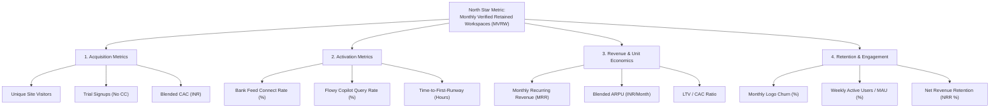

# FlowFinance Comprehensive KPI Framework & Unit Economics Architecture

**Document:** 06_KPI_Framework.md  
**Track:** Consulting & Business Development Track  
**Platform Focus:** FlowFinance ([flowfinancebusiness.com](https://www.flowfinancebusiness.com/))  
**Target Market:** Indian Founders, SMB Operators, and CA Practices  

---

## 1. Executive Summary: The Metrics-Driven Growth Engine

A high-performing growth strategy requires a unified measurement framework connecting granular acquisition activities to long-term enterprise valuation. For FlowFinance ([flowfinancebusiness.com](https://www.flowfinancebusiness.com/)), the key operational challenge is ensuring that top-of-funnel trial volume translates efficiently into high-retention, high-LTV paid subscriptions.

This framework details the **end-to-end KPI tree across Acquisition, Activation, Revenue, and Retention**, providing precise mathematical definitions, tracking cadences, and **starting operational targets explicitly labeled as Assumptions**.

---

## 2. The FlowFinance KPI Tree Architecture



---

## 3. Comprehensive Metric Definitions & Operational Targets

*(All targets are modeled as baseline strategic benchmarks for an early-stage Indian B2B SaaS platform and are explicitly labeled as **Assumptions** with underlying operational rationale).*

### 1. Acquisition KPIs

| Metric Name | Mathematical Definition / Formula | Tracking Cadence | Starting Target Benchmark | Operational Rationale & Assumption Basis |
| :--- | :--- | :--- | :--- | :--- |
| **Unique Website Visitors** | Total non-duplicate visitors browsing product, pricing, or comparison pages. | Weekly / Monthly | **15,000 / month** *(Assumption 1)* | Reflects combined inbound SEO, founder community distribution, and CA referral traffic. |
| **Visitor-to-Trial Conversion Rate** | $\frac{\text{Free Trial Signups}}{\text{Unique Website Visitors}} \times 100$ | Weekly | **4.5%** *(Assumption 2)* | Standard SaaS benchmark enabled by zero credit card friction on [flowfinancebusiness.com/pricing](https://www.flowfinancebusiness.com/pricing). |
| **Blended Customer Acquisition Cost (CAC)** | $\frac{\text{Total Sales + Marketing Spend (INR)}}{\text{Total Verified Paid Customers Acquired}}$ | Monthly | **₹4,500 / customer** *(Assumption 3)* | Weighted blend across low-cost CA networks, community masterclasses, and targeted LinkedIn campaigns. |

### 2. Activation KPIs (The "Aha!" Funnel)

| Metric Name | Mathematical Definition / Formula | Tracking Cadence | Starting Target Benchmark | Operational Rationale & Assumption Basis |
| :--- | :--- | :--- | :--- | :--- |
| **Data Ingestion Activation Rate** | $\frac{\text{Workspaces Connecting Bank (AA or Statement)}}{\text{Total Trial Signups}} \times 100$ | Daily / Weekly | **55.0%** *(Assumption 4)* | The critical inflection point. Requires smooth Account Aggregator OTP handshake and PDF statement fallback. |
| **Time-to-First-Runway (TTV)** | Elapsed time from registration to viewing the 90-day runway projection. | Real-time | **< 15 minutes** *(Assumption 5)* | Immediate time-to-value minimizes user abandonment before trial Day 1 concludes. |
| **Copilot Engagement Depth** | $\frac{\text{Users Asking }\ge 2\text{ Flowy Queries}}{\text{Total Trial Signups}} \times 100$ | Weekly | **60.0%** *(Assumption 6)* | Validates that non-finance founders are actively using natural language queries to explore their financials. |

### 3. Revenue & Commercial KPIs

| Metric Name | Mathematical Definition / Formula | Tracking Cadence | Starting Target Benchmark | Operational Rationale & Assumption Basis |
| :--- | :--- | :--- | :--- | :--- |
| **Trial-to-Paid Conversion Rate** | $\frac{\text{Verified Paid Conversions}}{\text{Activated Trial Workspaces}} \times 100$ | Weekly / Cohort | **22.0%** *(Assumption 7)* | Realistic benchmark for users who connect live financial data, establishing high switching barriers. |
| **Blended Average Revenue Per User (ARPU)** | $\frac{\text{Total Monthly Subscription Revenue}}{\text{Total Active Paid Subscribers}}$ | Monthly | **₹3,200 / month** *(Assumption 8)* | Weighted average based on plan distribution: 55% Essential (₹1,999), 35% Growth (₹3,999), and 10% Professional (₹7,999) ([flowfinancebusiness.com/pricing](https://www.flowfinancebusiness.com/pricing)). |
| **Monthly Recurring Revenue (MRR)** | $\sum (\text{Active Subscribers} \times \text{Tier Price})$ | Monthly | **₹16,00,000 (Month 12)** *(Assumption 9)* | Represents 500 active paid workspaces at blended ARPU of ₹3,200/mo. |

### 4. Retention & Health KPIs

| Metric Name | Mathematical Definition / Formula | Tracking Cadence | Starting Target Benchmark | Operational Rationale & Assumption Basis |
| :--- | :--- | :--- | :--- | :--- |
| **Monthly Logo Churn** | $\frac{\text{Workspaces Cancelling in Month}}{\text{Total Active Workspaces at Start of Month}} \times 100$ | Monthly | **< 2.5% / month** *(Assumption 10)* | Financial software with live bank syncing displays high customer stickiness once integrated into daily routines. |
| **Net Revenue Retention (NRR)** | $\frac{(\text{Beginning MRR} + \text{Expansion} - \text{Churn} - \text{Contraction})}{\text{Beginning MRR}} \times 100$ | Quarterly / Annual | **> 110%** *(Assumption 11)* | Driven by seat upgrades, tier jumps (Essential to Growth/Professional), and CA multi-workspace expansion. |
| **Weekly Active Users / MAU Ratio** | $\frac{\text{Weekly Active Logins}}{\text{Monthly Active Logins}} \times 100$ | Monthly | **> 45.0%** *(Assumption 12)* | High frequency driven by Monday morning automated cash digest emails and WhatsApp alerts. |

---

## 4. Unit Economics & LTV/CAC Derivation Model

To validate the commercial viability of FlowFinance's growth strategy, we model the fundamental unit economics:

```
[Unit Economics Inputs & Assumptions]
• Blended ARPU: ₹3,200 / month (₹38,400 / year) [Assumption 8]
• Gross Margin: 85% (cloud hosting, Account Aggregator API costs, AI inference overhead) [Assumption 13]
• Monthly Churn Rate: 2.5% [Assumption 10]
• Average Customer Lifetime (Months): 1 / Churn = 1 / 0.025 = 40 Months (3.33 Years)
• Blended CAC: ₹4,500 [Assumption 3]
```

### Mathematical Derivations

1. **Customer Lifetime Value (LTV):**
   $$\text{LTV} = \text{ARPU} \times \text{Gross Margin} \times \text{Customer Lifetime (Months)}$$
   $$\text{LTV} = ₹3,200 \times 0.85 \times 40 = ₹1,08,800$$

2. **LTV to CAC Ratio:**
   $$\frac{\text{LTV}}{\text{CAC}} = \frac{₹1,08,800}{₹4,500} = \mathbf{24.18\times}$$
   *(Note: An LTV/CAC ratio above 5x indicates outstanding capital efficiency, driven by low-cost CA referral flywheels and organic community channels).*

3. **CAC Payback Period:**
   $$\text{Payback Period} = \frac{\text{CAC}}{\text{ARPU} \times \text{Gross Margin}} = \frac{₹4,500}{₹3,200 \times 0.85} = \mathbf{1.65\text{ Months}}$$
   *(Note: FlowFinance recovers its acquisition cost in under 50 days, allowing rapid reinvestment of cash flows into further business development).*

---

## 5. Executive Operational Dashboard Cadence

To maintain operational rigor across the consulting engagement, metrics should be reviewed across three distinct cadences:

```mermaid
flowchart LR
    subgraph Daily Cadence (Operational)
        D1["Trial Signups"] --- D2["AA Bank Connect Rate"] --- D3["Flowy AI Errors"]
    end
    subgraph Weekly Cadence (Tactical)
        W1["Trial-to-Paid Conversion"] --- W2["CA Partner Activations"] --- W3["Channel CAC"]
    end
    subgraph Monthly Cadence (Strategic)
        M1["MRR & ARR Growth"] --- M2["Net Revenue Retention (NRR)"] --- M3["LTV / CAC Payback"]
    end
```

---

*Sources Cited in this Document:*
1. [FlowFinance Official Website & Pricing](https://www.flowfinancebusiness.com/pricing)
2. [FlowFinance Features & Capabilities](https://www.flowfinancebusiness.com/features)
3. [Bessemer Venture Partners - State of the Cloud / SaaS Metrics Framework](https://www.bvp.com/)
4. [David Skok - SaaS Metrics 2.0 (For Entrepreneurs)](https://www.forentrepreneurs.com/)
