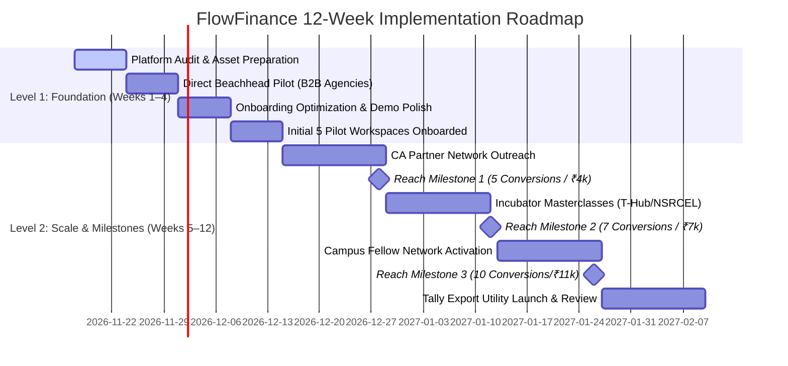

# FlowFinance Phased Implementation Roadmap & Challenge Milestones

**Document:** 07_Roadmap.md  
**Track:** Consulting & Business Development Track  
**Platform Focus:** FlowFinance ([flowfinancebusiness.com](https://www.flowfinancebusiness.com/))  
**Target Market:** Indian Founders, SMB Operators, and CA Practices  

---

## 1. Executive Summary & Challenge Architecture

This implementation roadmap translates the strategic frameworks into a concrete, week-by-week execution plan. It is structured around the two core competitive levels of the FlowFinance Growth Challenge:

* **Level 1 (Weeks 1–4): Foundation, Positioning & Beachhead Pilot:** Deep platform diagnostics, competitor benchmarking, messaging validation, and onboarding initial pilot cohorts.
* **Level 2 (Weeks 5–12): Acquisition Engine, Distribution Scale & Commercial Conversions:** Scaled activation across CA partner networks, startup communities, campus ambassadors, and institutional incubators to drive verified paid conversions.

### Level 2 Incentive Structure Alignment
Under the challenge parameters, business development performance is measured against verified paid conversions:
* **Base Commission:** **10% commission on the first-month subscription** per verified paid conversion ([flowfinancebusiness.com/pricing](https://www.flowfinancebusiness.com/pricing)).
* **Milestone 1:** **5 verified paid conversions** $\rightarrow$ **₹4,000 cash bonus** (+ accumulated 10% commissions).
* **Milestone 2:** **7 verified paid conversions** $\rightarrow$ **₹7,000 cash bonus** (+ accumulated 10% commissions).
* **Milestone 3:** **10 verified paid conversions** $\rightarrow$ **₹11,000 cash bonus** (+ accumulated 10% commissions).

---

## 2. Week-by-Week Operational Execution Plan

### Detailed Week-by-Week Breakdown

#### Level 1: Foundation & Direct Beachhead (Weeks 1–4)

* **Week 1: Platform Ingestion & Asset Development**
  * Finalize messaging scripts, competitor positioning cards, and the interactive demo walkthrough.
  * Audit Account Aggregator live sync stability across major Indian banks (HDFC, ICICI, SBI, Axis).
  * Deploy automated PDF/Excel bank statement parsing fallback for non-AA banks.

* **Week 2: Direct Beachhead Launch (B2B Services Agencies)**
  * Launch consultative outreach targeting 50 boutique digital, IT, and performance marketing agencies.
  * Deliver the value proposition: *"Real-time receivables aging and automated 90-day cash flow forecasting."*
  * Offer complimentary 1-on-1 concierge onboarding into the 7-day free trial.

* **Week 3: Time-to-Value (TTV) Optimization & Funnel Tuning**
  * Measure onboarding drop-offs; refine in-trial email and WhatsApp nudges.
  * Integrate Monday morning automated cash digest previews to drive day-to-day engagement.
  * Test Flowy AI Copilot query suggestions directly in the onboarding flow.

* **Week 4: Level 1 Milestone Review & Pilot Signoff**
  * Complete Level 1 deliverables and achieve first 5 active pilot trial workspaces.
  * Gather founder feedback on runway forecasting accuracy and MIS report presentation quality.
  * Lock in partner collateral for the Level 2 CA distribution campaign.

---

#### Level 2: Scaled Distribution & Milestone Execution (Weeks 5–12)

* **Week 5–6: CA Partner Network Activation $\rightarrow$ Targeting Milestone 1 (5 Conversions)**
  * Initiate the *FlowFinance Certified Advisor* outreach across 40 boutique CA firms in Mumbai, Pune, and Bengaluru.
  * Present the CA practice value exchange: Automated MIS generation and 60% reduction in monthly client review time.
  * **Milestone 1 Gate (End of Week 6):** Secure **5 verified paid conversions** across agency and early CA client workspaces $\rightarrow$ **Unlocks ₹4,000 Milestone Reward** + 10% subscription commissions.

* **Week 7–8: Institutional Incubator Alliances $\rightarrow$ Targeting Milestone 2 (7 Conversions)**
  * Finalize partnership agreements with regional startup incubators (T-Hub, NSRCEL, IIT E-Cells).
  * Host virtual runway planning masterclasses: *"How to Build a Dynamic 3-Scenario Runway Model."*
  * **Milestone 2 Gate (End of Week 8):** Scale to **7 verified paid conversions** $\rightarrow$ **Unlocks ₹7,000 Cumulative Milestone Reward** + 10% subscription commissions.

* **Week 9–10: Campus Ambassador Network & Scaling $\rightarrow$ Targeting Milestone 3 (10 Conversions)**
  * Onboard 15 student venture fellows across top B-schools and engineering entrepreneurship cells.
  * Conduct campus demo sessions targeting student-led and alumni early-stage ventures.
  * **Milestone 3 Gate (End of Week 10):** Scale to **10 verified paid conversions** $\rightarrow$ **Unlocks ₹11,000 Maximum Milestone Reward** + 10% subscription commissions.

* **Week 11–12: Ecosystem Deepening, Tally Bridge & Commercial Review**
  * Launch the lightweight Tally XML/TDL data export utility, allowing CAs to export categorized FlowFinance transactions directly into TallyPrime ledgers.
  * Conduct 60-day customer retention and net revenue retention (NRR) review across early cohorts.
  * Synthesize final consulting findings, CAC metrics, and expansion playbooks for the executive board.

---

## 3. Commercial Economics & Commission Modeling (Level 2)

Based on FlowFinance’s public subscription plans ([flowfinancebusiness.com/pricing](https://www.flowfinancebusiness.com/pricing)):
* **Essential Plan:** ₹1,999 / month $\rightarrow$ 10% Commission: **₹199.90**
* **Growth Plan:** ₹3,999 / month $\rightarrow$ 10% Commission: **₹399.90**
* **Professional Plan:** ₹7,999 / month $\rightarrow$ 10% Commission: **₹799.90**
* *Blended Average Commission per Conversion:* **₹320.00** *(Based on weighted mix of 55% Essential, 35% Growth, 10% Professional)*.

### Total Student Participant Earnings Model

| Verified Conversions Target | Base 10% Subscription Commissions (INR) | Official Challenge Milestone Cash Bonus (INR) | Total Gross Earnings (INR) | Effective Earnings Per Conversion (INR) |
| :---: | :---: | :---: | :---: | :---: |
| **5 Conversions (Milestone 1)** | ₹1,600 | **₹4,000** | **₹5,600** | ₹1,120 / conversion |
| **7 Conversions (Milestone 2)** | ₹2,240 | **₹7,000** | **₹9,240** | ₹1,320 / conversion |
| **10 Conversions (Milestone 3)** | ₹3,200 | **₹11,000** | **₹14,200** | ₹1,420 / conversion |

---

## 4. Comprehensive Risk Matrix & Mitigation Strategies

| Risk Category | Identified Risk Scenario | Severity | Likelihood | Mitigation Strategy & Operational Safeguard |
| :--- | :--- | :--- | :--- | :--- |
| **Operational** | **Bank Account Aggregator Downtime:** Bank OTP gateway failures prevent users from completing bank sync during trial. | High | Moderate | **Immediate Fallback Ingestion:** Provide drag-and-drop PDF/Excel statement parser with AI OCR; allow users to experience instant value without waiting for bank AA resolution. |
| **Channel** | **CA Inertia due to Tally Loyalty:** Chartered Accountants refuse to adopt FlowFinance because it doesn't replace their core Tally ledger. | High | High | **Position as Overlay, Not Replacement:** Emphasize that FlowFinance is an advisory and MIS generation layer; provide one-click Tally XML export so CAs never have to duplicate data entry. |
| **Compliance** | **Risk of Fraudulent or Self-Referrals:** Users attempting to trigger milestone bonuses via fake companies or circular signups. | High | Low | **Strict Verification Protocol:** Every conversion must link to a verified Indian legal entity (active GSTIN or business bank statement); zero commissions paid on personal or non-operational accounts. |
| **Market** | **Price Sensitivity in Tier 2/3 MSMEs:** Micro-businesses viewing ₹1,999/month as expensive relative to basic billing apps (Vyapar at ₹2,399/year). | Moderate | Moderate | **Focus on Core Beachhead:** Target high-margin B2B service agencies and venture-backed startups where ₹1,999–₹3,999/mo is negligible compared to the cost of delayed receivables or hiring a finance analyst. |
| **Product** | **Flowy AI Hallucination Risk:** Conversational copilot misinterpreting ambiguous accounting entries. | High | Low | **Deterministic Financial Engine:** Ensure that all financial math (runway, burn, cash balance) is calculated deterministically via code; Flowy AI only translates the verified numbers into natural language. |

---

## 5. Comprehensive Master Sources List

Every market statistic, competitor benchmark, and regulatory figure cited across this strategy is drawn exclusively from verifiable public records:

1. **FlowFinance Platform & Commercials:**
   * [FlowFinance Official Website](https://www.flowfinancebusiness.com/)
   * [FlowFinance Pricing & Plans](https://www.flowfinancebusiness.com/pricing)
   * [FlowFinance Core Features & Platform Modules](https://www.flowfinancebusiness.com/features)
   * [FlowFinance Competitor Comparison Hub](https://www.flowfinancebusiness.com/compare)
   * [FlowFinance About Us & Founding Team](https://www.flowfinancebusiness.com/about)
   * [FlowFinance Privacy Policy & Terms of Service](https://www.flowfinancebusiness.com/privacy)

2. **Official Government & Regulatory Sources:**
   * [Ministry of Micro, Small and Medium Enterprises (MSME) Dashboard](https://msme.gov.in/)
   * [Press Information Bureau (PIB) - Udyam Registration Milestones](https://pib.gov.in/)
   * [Ministry of Finance - Section 43B(h) Regulations (Income Tax Act)](https://incometaxindia.gov.in/)
   * [Reserve Bank of India (RBI) - Account Aggregator Framework Master Directions](https://www.rbi.org.in/)
   * [Ministry of Electronics and Information Technology (MeitY) - Digital Personal Data Protection Act, 2023](https://www.meity.gov.in/)

3. **Industry Reports & Competitor Benchmarks:**
   * [Economic Times / GAME / FISME - MSME Delayed Payments Report](https://economictimes.indiatimes.com/small-biz/sme-sector/delayed-payments-crisis-msmes-blocked-funds-working-capital/articleshow/96328994.cms)
   * [Zoho Books Plans & Pricing](https://www.zoho.com/in/books/pricing/)
   * [Tally Solutions (TallyPrime Licensing)](https://tallysolutions.com/)
   * [Refrens Invoicing & Business Tools](https://www.refrens.com/)
   * [Bessemer Venture Partners - State of the Cloud / SaaS Benchmarks](https://www.bvp.com/)
